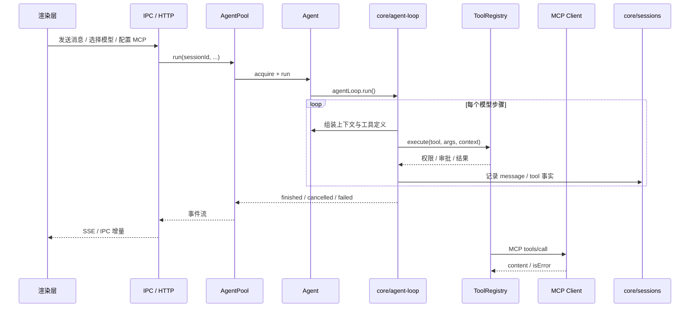

# Agent 当前技术架构（已落地）

```mermaid
flowchart TB
  subgraph UI["渲染层 · Chromium 108"]
    direction LR
    CHAT["聊天 / 消息 / 步骤时间线<br/>计划卡片 / 审批卡片"]
    CAP["能力中心<br/>技能 · 插件 · 定时任务 · MCP 连接器"]
    WORK["文件面板 / 编辑器<br/>终端 / Markdown / SVG 预览"]
  end

  subgraph BRIDGE["桥接层"]
    direction LR
    PRELOAD["desktop preload<br/>window.dsh IPC"]
    WEB["web-bridge.js<br/>HTTP / SSE"]
  end

  subgraph ENTRY["应用入口"]
    direction LR
    MAIN["Electron main<br/>开发态 electron ."]
    SERVICE["Agent Service<br/>server/index.js<br/>打包态 127.0.0.1:8080+"]
  end

  subgraph CORDIS["Cordis 4.0.0-rc.11 运行时底座 · 固定随包"]
    HOST["PluginHost / Cordis Context<br/>依赖注入 · 激活/挂起 · 异步清理 · 事件"]
    POOL["AgentPool<br/>一条会话一个 worker<br/>并发上限 / LRU / 取消"]

    subgraph LOWER["契约 · 纯策略 · 状态"]
      C["contracts<br/>服务接口 / 事件 / 工具与参数校验"]
      F["flow<br/>轮次限制 / 重试 / 工具决策 / 结果归类"]
      S["state<br/>唯一会话状态 reducer<br/>受控迁移"]
    end

    subgraph BASE["基础服务插件"]
      CFG["core/config<br/>Settings / Agent 配置"]
      PERM["core/permissions<br/>权限与审批策略"]
      TOOLS["core/tools<br/>ToolRegistry"]
      PROMPT["core/prompts<br/>系统提示词组装"]
      CONTEXT["core/context<br/>上下文预算与压缩"]
      SKILLS["core/skills<br/>Markdown 技能宿主"]
    end

    subgraph AGENT["Agent 执行插件"]
      LLM["core/llm<br/>OpenAI-compatible 请求"]
      SESS["core/sessions<br/>事件日志 / 快照 / 恢复"]
      MEM["core/memory<br/>摘要 / 压缩 / 合并"]
      LOOP["core/agent-loop<br/>run-turn 执行器"]
      AGENTS["core/agents<br/>Agent 实例生命周期"]
    end

    subgraph FEATURE["已落地能力插件"]
      PLANS["core/plans<br/>update_plan 工具"]
      SKILLLIB["core/skill-library<br/>统一技能库服务"]
      TASKS["core/tasks<br/>30s 调度 / 无人值守执行"]
      MCP["core/mcp<br/>MCP 连接与工具注册"]
    end
  end

  subgraph TOOLING["工具与外部能力"]
    BUILTIN["内置工具<br/>fs / search / shell / browser<br/>self-validate / skill"]
    MCPCLIENT["MCP 客户端<br/>stdio 子进程 / Streamable HTTP"]
    MODELS["外部模型服务<br/>OpenAI-compatible"]
  end

  subgraph DATA["本地持久化 · AGENT_HOME"]
    SETTINGS["settings.json<br/>模型 / 权限 / mcpServers / disabledSkills"]
    SESSIONDATA["sessions/&lt;id&gt;/<br/>events.jsonl + last-session.json"]
    TASKDATA["tasks/<br/>tasks.json + runs.jsonl + owner.json"]
    UIDATA["ui-store.json<br/>会话列表 / 界面偏好"]
    SKILLDATA["md-skills/<br/>随包 Markdown 技能"]
  end

  CHAT --> PRELOAD
  CHAT --> WEB
  CAP --> PRELOAD
  CAP --> WEB
  WORK --> PRELOAD
  WORK --> WEB

  PRELOAD --> MAIN
  WEB --> SERVICE
  MAIN --> HOST
  SERVICE --> HOST

  HOST --> LOWER
  HOST --> BASE
  HOST --> AGENT
  HOST --> FEATURE
  MAIN --> POOL
  SERVICE --> POOL
  POOL --> AGENTS

  LOOP --> F
  LOOP --> S
  LOOP --> LLM
  LOOP --> TOOLS
  LOOP --> SESS
  LOOP --> MEM
  LLM --> MODELS

  TOOLS --> BUILTIN
  MCP --> MCPCLIENT
  MCP --> MCPSTATE
  MCPCLIENT --> TOOLS
  MCPCLIENT --> MCPSERVER["用户配置的 MCP server<br/>可信本地命令 / 内网 endpoint"]
  MCPCLIENT --> MCPSTATE["连接状态 / 工具清单<br/>不进入会话状态 reducer"]

  TASKS --> POOL
  TASKS --> TASKDATA
  SESS --> SESSIONDATA
  CFG --> SETTINGS
  SKILLLIB --> SKILLDATA
  SKILLS --> SKILLDATA
  PRELOAD --> UIDATA
  WEB --> UIDATA
  SERVICE --> UIDATA

  classDef landed fill:#eef4ff,stroke:#315a9a,color:#17345f
  classDef external fill:#f6f6f6,stroke:#777,color:#333
  classDef data fill:#f8f2e7,stroke:#9a742b,color:#4d360e
  class UI,BRIDGE,ENTRY,CORDIS,TOOLING landed
  class MODELS,MCPSERVER external
  class DATA,SETTINGS,SESSIONDATA,TASKDATA,UIDATA,SKILLDATA,MCPSTATE data
```

## 关键调用链

## 已落地边界

- 渲染层不直接执行文件、命令、MCP 或模型请求，只通过 preload IPC / HTTP 桥接。
- `contracts` 与 `flow` 保持纯逻辑；`state` 只做受控状态迁移；IO 和副作用在上层插件。
- 所有工具，包括 MCP 工具，都经过同一个 `ToolRegistry` 权限、审批、取消和禁用检查。
- 定时任务通过 `AgentPool.runUnattended()` 复用同一个 Agent 执行链，不另建执行循环。
- MCP 服务由 `core/mcp` 管理生命周期，连接状态不进入会话状态 reducer。
- 会话事实持久化在 `events.jsonl` 和 `last-session.json`；任务事实独立在 `tasks/`。
