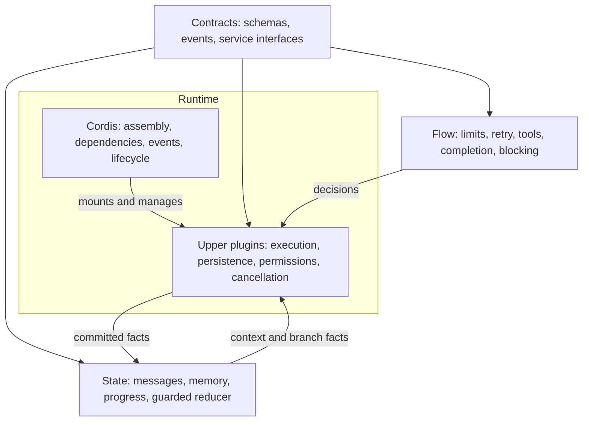
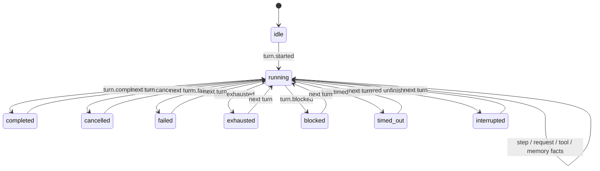

# Agent architecture: contracts, flow, state, runtime (0.3.0)

Cordis is the mandatory **runtime foundation**. It assembles plugins, resolves
service dependencies, dispatches events and manages plugin/resource lifetimes.
The Agent's execution policy, state model, persistence, tools and cancellation
are implemented by upper-layer plugins. Cordis itself does not define them.

## 长期设计原则：兼容的运行时，先进的架构

本项目只因 Windows 7 兼容性而约束运行技术版本，不因此降低架构设计标准。
交付运行时锁定 Electron 22.3.27 / Node 16.17.1 / Chromium 108；新能力通过
平台无关契约和可替换适配器落地。Cordis 插件装配、纯策略、受控状态迁移、事实日志、
取消与生命周期管理、可观测性和回归验证，是持续演进的基础。

技术选型不能以“最新版本”代替设计判断，也不能以“支持 Win7”解释耦合、隐式状态
或不可测试的实现。重要变更必须记录问题、边界、兼容方案、验证证据与替换路径。
完整长期规则见仓库根目录 `AGENTS.md`；平台约束见 `docs/WIN7-COMPAT.md`。

## Desktop source protection boundary

The desktop build transforms its staging copy only. Native CommonJS modules use per-module
AES-GCM payloads and a minimal Node16 loader; browser scripts and sandbox preloads use
build-time minification/obfuscation. The loader preserves module identity and caching and
owns no Agent state, service container, IO policy or workflow semantics. Cordis vendor and
public interfaces remain unchanged. The replaceable build/loader adapter can evolve toward
runtime-pinned bytecode later without changing business contracts. Offline key extraction
and runtime inspection remain possible. See docs/DESKTOP-DELIVERY.md for scope and evidence.

## Model network boundary

Model catalog and the selected Cordis model service share the replaceable
`agent/network-proxy.js` Node-16 IO adapter; the adapter owns no conversation
state or execution policy. It reads explicit environment configuration before
macOS or Windows manual user proxies, respects private literals and bypass
lists, and keeps HTTPS target verification inside a standard CONNECT tunnel.
Proxy discovery is cached for two seconds; the bounded system-command lookup
is synchronous (at most one second per uncached lookup). Unsupported detected
PAC/WPAD and SOCKS-only settings fail visibly rather than silently bypassing the
proxy. Linux desktop proxy settings, WinHTTP and arbitrary DNS names that resolve
to private addresses are not automatically interpreted. See the README for
precedence and limitations.

`scripts/network-proxy-smoke.js` exercises policy, local HTTP/HTTPS proxies,
TLS and hostname verification, model catalog/chat/Ollama, cancellation,
midstream disconnects and timeouts without real credentials; `check:node16`
runs the same script under Electron's embedded Node. These tests are not Win7
hardware validation. Future platform-specific asynchronous proxy resolution
or a supported PAC/SOCKS adapter can replace discovery/transport without
changing model contracts or Cordis assembly.

### Conversation model reconnection

A transient transport failure after completed tools formerly terminated the turn.
The selected `flow` service now classifies retryable failures and provides bounded
backoff in its limits; the upper Agent loop commits each request/failure decision
through the existing versioned journal, waits with the turn's AbortSignal, and
reissues only the current model request. Limits, timeout, unattended budgets and
Cordis service selection still apply. Completed tool facts remain in the session;
there is no automatic replay of a tool or recovery of uncertain side effects.

The Node16 transport treats EOF before the protocol completion marker as an
incomplete stream rather than a successful partial tool call. Per-request IDs and
an additive UI retry event separate abandoned streamed drafts from the next
attempt, including when the UI misses the retry event. Failure remains visible
after the retry budget, and old snapshots/UI event consumers remain readable.
The provider may bill a failed request or independently propose a tool again;
this is not stream resumption or exactly-once execution. `model-reconnect-smoke`
exercises actual Cordis, a real TLS disconnect, clean/aborted stream endings,
cancellation, deadline, retry exhaustion and retained tool facts. The isolated
Chromium and protected-package tests exercise UI and bundled runtime separately;
none of these substitute for a real Win7 test. A future provider-specific
idempotent/resumable model adapter can replace request reissue without changing
the persisted conversation/tool boundary.

## Long-term memory and adaptive capabilities

`core/memory-store` wraps a separate SQLite 3.54/FTS5 database under the user
data directory. It owns durable, user-visible memories and evidence/revision
history, not conversation execution state; the existing `memory` service still
owns context compression. Memory extraction runs asynchronously on
`agent:afterRun`, stores explicit facts/preferences, and leaves inferred task
experience as candidates requiring confirmation. Sensitive values are rejected
before persistence. Retrieval is scoped by user/project/session and only active,
non-expired entries are injected as bounded reference data.

`core/capability-registry` projects the live `tools`, `skillLibrary`,
`workflows`, `mcp` and `extensions` services; it has no independent capability
database. `core/adaptive` combines that projection with the memory store to
produce deterministic, read-only plans and recommendations. It never installs,
changes permissions, starts a workflow or executes a tool. The existing Agent
loop, tool registry, licensing, approval and cancellation paths remain the only
execution path. See `docs/ADAPTIVE-AGENT.md` for the current limits.

## TypeScript boundaries

New compile-time contracts live in `types/` and are checked with `strict: true`
by `tsconfig.types.json`; they never enter the target application. The core
JavaScript modules (`contracts`, `flow`, `state`), both preloads, and the pure
renderer/transport modules are checked with `checkJs` through separate
`tsconfig` files. This keeps one runtime implementation while giving callers
typed events, services, flow decisions, reducer state and browser/build
boundaries. `scripts/typecheck-core.js` also rejects `.ts`/`.tsx` files under
the shipped paths and type suppressions in non-test declarations. Type
declarations are erased at build time; runtime validators and Cordis remain
authoritative. Server, shell and the large renderer entry points remain JS and
are constrained by declarations until their own migration batches.

## Four layers and dependency direction

| Layer | Responsibility | Implementation |
| --- | --- | --- |
| Contracts / protocols | Service methods, model/tool boundaries, event vocabulary and versions | `src/main/contracts/` |
| Flow / orchestration policy | Prompt policy, retry/compaction choices, tool/finish/block decisions and limits | `src/main/flow/` |
| State model | Pure guarded transitions of messages, memory, turn/step/request/tool progress | `src/main/state/session-state.js` |
| Upper runtime plugins | Execute policy, call services, commit facts, enforce cancellation/deadlines and persist state | `src/main/runtime/plugins/`, `run-turn.js`, `context-memory.js`, `state/session-repository.js` |
| Runtime foundation | Context, service graph, events, activation and teardown | Pinned actual Cordis bundle |



Contracts and flow import no IO, platform or runtime implementations. The state
reducer imports only contracts. The repository is an explicitly separate IO
adapter despite residing next to the state model. Runtime plugins depend on these
lower layers; the lower layers never import Cordis. Automated guards enforce
these boundaries and reject direct message mutation in the turn executor.

## Composition and executable entry points

`runtime/profile.js` only selects plugins. `runtime/plugins/foundation.js`
provides contracts, flow, state, settings, permissions, tools, prompts, context and
skills. Separate native plugins provide model access, persistence, compaction,
the turn executor and Agent creation.

HTTP/SSE and Electron IPC both await activation before serving work. AgentPool
keeps per-session workers/concurrency; the public Agent is a state/service facade.
Every turn invokes the selected `agentLoop` service. The executor consumes its
**injected Cordis service view** until the turn drains. Replacing flow or model
services therefore changes real execution, and dependency teardown cancels active
work before providers disappear. `agent/agent-loop.js` is a compatibility export.

## Contracts at real boundaries

The node designer resolves request-local model IDs from configured providers in
its existing Cordis plugin; catalog transport omits connection secrets. The pure
`workflow-designer-options` contract validates this selection. User-selected node
run permissions map to the existing `agent.permission` / `tool.permission` fields,
then flow through immutable workflow run snapshots and the existing tool registry.
Design proposals cannot elevate the selected permission. All three permission
levels retain the fixed Headless allowlist and limits; no new tool loop or service
container is introduced. The implementation uses Node16/Chromium108 primitives;
the transport/model adapter can later change without changing the design protocol.

- `contracts.SERVICES` specifies service method requirements checked at executor
  activation. Incomplete providers fail activation rather than silently falling
  back to another execution path.
- Model results are checked at the model adapter and executor boundaries,
  including tool names, argument encoding and duplicate IDs.
- Tool definitions and arguments are checked before approval and execution.
  Runtime validation covers the JSON Schema subset used by local tools: type,
  required, enum, properties, array items and additionalProperties. Remote `$ref`
  resolution and the full JSON Schema specification are not implemented.
- Durable domain events have explicit version, sequence, timestamp, type and
  payload. They are separate from the existing UI streaming events.
- `EVENT_MODES` describes extension events: `llm:request` / `tools:execute` use
  around middleware; `state:committed` is an asynchronous observation event after
  persistence. Observer failures are logged and do not undo committed facts.

Existing tool plugin APIs remain available through `PluginHost` / `PluginContext`
compatibility adapters. New core plugins use native Cordis contexts and `inject`.
There is no parallel service container, event registry or dependency scheduler.

## Flow and state

The pure `flow` service receives facts and returns explicit decisions. Its default
policy chooses tool fallback, context compaction, tool execution, completion,
permission blocking, maximum steps/attempts and an optional turn deadline. A
replacement policy is exercised through the same public Agent entry point.

The state reducer validates sequence and legal transitions. It owns the only
conversation state, with immutable messages, memory and execution records:



Execution state includes turn ID, phase, step, request attempt, active tool,
consecutive denials, tool-support fallback and last request error. Flow decisions
read these facts rather than maintaining competing flags. Streaming fragments and
AbortControllers are transient runtime resources, not durable state.

`turnTimeoutMs` defaults to `0` (no additional whole-turn deadline), capped at
24 hours. Model request timeouts still apply. Cancellation is cooperative: tools
receive an AbortSignal, and teardown waits for in-flight operations to settle.
An arbitrary trusted plugin that ignores cancellation cannot be forcibly undone.

`/api/state` and Electron state expose `executions` per live worker, in addition
to Cordis plugin diagnostics under `runtime`. The existing renderer event API and
legacy session JSON fields remain compatible.

## Persistence and recovery

The `sessions` plugin owns filesystem IO. Each session directory contains:

- `events.jsonl`: appended, versioned domain facts; continuous sequence numbers.
- `last-session.json`: atomic snapshot retaining `version: 2`, `messages` and
  `memory`, with additive `stateVersion`, `sequence` and `execution` fields.

For each change the runtime computes/validates the next state, appends the fact,
then exposes that state. Terminal snapshots are written for success, cancellation,
failure, denial limits, step exhaustion and deadline expiry. Old message-only
snapshots are migrated in memory without deleting user history.

On load the repository restores the snapshot and replays newer journal events.
A final line lacking its newline is an interrupted write and is truncated before
new appends. A malformed **committed** line, unknown version or sequence gap is an
error; it is not silently discarded. This is process-interruption recovery, not a
power-loss/fsync guarantee. After publishing a complete atomic snapshot, the
repository truncates its redundant journal; a failed truncation leaves facts
that recovery safely skips by sequence. It is a recovery journal, not a permanent
audit archive. Session, task and workflow repositories share a 64KiB incremental
JSONL IO adapter, keeping one fact at a time rather than a whole-file event array.

An unfinished turn is recorded as interrupted before accepting the next turn.
Incomplete tool batches get explicit missing-result placeholders so model history
remains valid. Actual results from all tools in a batch are preserved. Recovery
restores context and progress; it does **not** automatically repeat uncertain
external side effects or promise exactly-once tool execution.

At idle, workers release heavy in-memory message payloads while retaining progress;
the next turn restores durable state. Explicit client history can replace the
conversation view, preserving the existing UI contract. Journal writers assume
one owning Agent service per session directory; they reject stale in-process
writers rather than offering distributed locking.

## Lifecycle and distribution

Cordis owns activation, dependency suspension/reactivation and asynchronous
cleanup. Settings disable/remount actual tool plugin fibers. Model/flow/loop
replacement drains dependent work; a failed replacement restores its predecessor.
Agent disposal closes its browser/background processes. Both application entries
await normal shutdown. Cordis is trusted in-process infrastructure, not a sandbox.

The actual upstream Cordis `4.0.0-rc.11` and cosmokit `1.8.1` are bundled as CJS
for Node 16.17, pinned with package integrities, SHA-256 and MIT notices. Production
has no package dependencies or runtime downloads. Do not edit generated code.

```sh
# Normal acceptance; no vendor install needed
npm run check
npm run check:node16
# Explicit upstream maintenance only; initial installation needs internet
npm ci --prefix scripts/cordis-vendor
npm run vendor:cordis
```

All desktop packages and Docker include contracts, flow, state, runtime plugins
and the offline Cordis bundle. Win7 SP1 x64 / Electron 22.3.27 remain mandatory.
Node 16 tests and cross-builds do not replace Windows hardware validation.

## 0.4：界面计划与运行事实

`core/plans` 是 profile 中的原生 Cordis 插件，声明 tools/prompts 依赖，通过 effect
注册 update_plan 工具并回收资源。计划内容只是工具结果，沿既有 message.appended
事实落盘；共享插件中没有会话进度或第二套执行策略。前端从消息恢复计划展示。

编码任务的提示沿用此插件，引导简短计划、读取相关文件与约束、最小端到端修改、
就近验证，以及根据实际错误修正；只有取得证据后才报告验证完成。对用户输出进度、
工具结果和阻塞，不暴露或编造模型私有思维链，不引入新模型 SDK、执行循环或能力等价承诺。

execution.startedAt 来自 turn.started 事件时间，属于状态 reducer 派生事实，兼容旧快照。
工具 UI 事件附带已记录的 outcome 与调用 ID；失败的命令退出码经纯 flow.outcome 归类，
界面不得把取消、失败或历史未确认步骤重画成成功。其余计时与展开状态仅为 UI 元数据。

## 能力中心：系统技能与现有插件

能力中心将设置页现有插件管理迁出，继续调用既有 settings 与 Cordis 插件启停路径。
连接器保留未开放空页；定时任务由后述原生 `core/tasks` 服务提供真实执行能力。

`core/skill-library` 在 profile 注册，inject `agentConfig`，提供系统统一 `skillLibrary` 服务。
服务封装既有 Markdown 技能索引与读取；`disabledSkills` 由既有 Settings repository 持久化。
提示词清单、搜索和直接加载共同读取该全局配置；短名加载先解析稳定 ID 再判断开关。
旧配置无 disabledSkills 时所有系统技能默认启用，既有插件停用配置保持兼容。
HTTP 与 Electron 状态接口提供同一服务的技能清单，UI 不扫描磁盘、不执行技能脚本。
该变更不改变 Agent 状态迁移和会话日志；技能启停影响后续清单构建与工具加载，不能撤回
已进入模型上下文的内容。实现仅使用 Node 16 内置能力，无新增生产依赖；更换桌面运行时
只需替换传输适配，能力服务接口和页面可继续使用。

验证记录：源码语法检查与交付包源码一致性核对；不将跨平台构建作为 Win7 真机验证。

## 定时任务：应用运行期间的无人值守执行

`core/tasks` 是 profile 中的原生 Cordis 插件，inject agentConfig/agents/tools/contracts，
提供 `tasks` 服务。HTTP 与开发态 IPC 只是传输适配。调度器每 30 秒检查；资源由
Cordis effect 管理，关闭时取消任务并等待执行结束，再释放数据目录所有权。

- `contracts/tasks.js`：版本、任务字段、工具白名单和资源限制校验。
- `flow/task-policy.js`：纯日历与补跑策略，支持 IANA 时区、每天、每周、固定间隔。
- `state/task-state.js`：仅依赖契约的运行记录状态迁移。
- `tasks/repository.js`：原子 JSON 快照、备份及 JSONL 事实日志；每任务保留最近
  100 条、全局最多 1000 条；启动截断未提交尾行，运行中记录改为中断。
- `runtime/plugins/tasks.js`：持久化触发、推进下次时间、调度及结果汇总。

触发编号由任务 ID 和原计划时间决定，先记录 pending，再推进 nextAt；重启可恢复
尚未开始的 pending（超过 24 小时取消），不会重放已开始的副作用。正常调度允许
一分钟检查宽限；超过宽限的错过默认跳过，启用补跑时仅补最近 24 小时内的一次。
间隔规则按原计划推进而非按任务结束时间漂移。夏令时缺失时刻跳过，重复时刻只执行一次。

同任务 pending/running 时后续触发记录 skipped；全局仅一个后台任务，池有多个名额
时为交互运行保留一个名额。任务持有修订快照与规范化工作目录，聊天切换目录不改变它。
新增 runUnattended 入口仍调用同一个 Agent.run → Cordis agentLoop → 状态仓库。
任务记录只关联会话 ID，完整对话沿已有 sessions 目录保存。

权限在 ToolRegistry 执行边界检查，模型无法扩大任务白名单。只读任务不执行命令或
浏览器；workspace 命令需完整精确授权、根目录执行并通过现有危险命令策略。
浏览器仅查看及指定来源导航，拒绝脚本与交互写操作。文件访问复用真实路径检查。
命令不是 OS 沙箱，浏览器导航来源限制不是网络隔离；可信插件仍是宿主信任边界。
首次拒绝即停止本批后续工具，记录需人工处理，不等待人工审批。

任务独立设置最大步骤、超时、模型请求数、输出字节及 token 保守预算。请求前按
消息/工具定义 UTF-8 字节数、回复额度及协议余量预留，不等同于供应商计费 token；
无人值守关闭自动压缩与重试，避免额外模型调用绕过预算。连续非成功达到阈值自动停用。
磁盘写入错误使调度暂停并向界面报告，需要处理故障并重启服务。存在未授权操作、
失败或中断时，记录与桌面通知均不含原文件内容；浏览器用户通过运行记录查看结果。

桌面壳提供明确可选的托盘常驻与开机自启，默认不擅自开启；托盘模式关闭窗口仅隐藏，
托盘菜单真正退出并停止服务；Windows 通知使用托盘气泡以覆盖 Win7，临时托盘在通知后或退出时释放。单实例沿用原有壳锁，任务仓库额外用独占 PID 所有权
保护同一 AGENT_HOME。远程连接在页面标明实际执行主机。没有新增生产依赖或进程，
Electron 22.3.27 / Node 16.17.1 / Chromium 108 保持不变。日常任务完成后沿用当前版本构建开发环境验收包；明确发版时才升级并构建全部平台。


任务验收：`npm run check:tasks` 覆盖日历/时区、夏令时、补跑、独占所有权、
日志恢复、真实 Cordis/AgentPool 执行、越权拒绝、重叠跳过、配置快照、预算、停止、
超时、失败停用及桌面生命周期模拟。`npm run check:tasks:browser` 使用隔离目录、
本机模型替身及实际 Chromium，覆盖任务页面、工具执行、历史恢复、重启及删除。
桌面模拟检查不会修改开发机的开机自启设置；没有将其当作 Win7 真机通知验证。

## MCP：外部工具通过既有工具边界接入

`core/mcp` 是 profile 中的原生 Cordis 插件，inject `agentConfig/tools/prompts/contracts`，
在 `ctx.effect()` 生命周期内连接用户配置的 MCP 服务。`contracts/mcp.js` 只做纯配置、
命名和结果格式化；`flow/mcp-policy.js` 只做暴露策略；`mcp/stdio-client.js` 与
`mcp/http-client.js` 是 IO 适配器；`runtime/plugins/mcp.js` 负责注册/注销工具和
Cordis 服务。

MCP 工具不建立第二套执行路径：发现后的工具通过 `ToolRegistry.register()` 注册，
调用仍经过 `ToolRegistry.execute()` 的权限、审批、取消与禁用插件检查。服务关闭时
工具 disposer 会中止在跑的 MCP 调用并等待子进程退出。HTTP 使用 Streamable HTTP，
stdio 使用按行 JSON-RPC；均只依赖 Node 16 内置模块，不增加运行时下载。

配置和连接状态不进入会话状态 reducer，也不伪造计划/进度事实。宿主仅暴露工具结果；
MCP resources/prompts/sampling 尚未实现，未知能力返回 JSON-RPC 错误。
验证入口为 `npm run check:mcp`，覆盖真实 stdio/HTTP 假服务与 Cordis 工具注册。

### 内置文档 MCP

`core/mcp` 使用注入的 tools/prompts 装配随包文档服务。纯契约
`contracts/document-tools.js` 定义六个工具及 Schema；`mcp/documents/host.js` 是
MCP 客户端适配，每次调用以可信 toolCtx.workspaceRoot 启动独立 stdio 进程，完成真实
握手、发现和调用，不将会话目录放到共享插件状态。读取/写入分别走现有 read/write
权限，调用事实仍走原有会话 reducer/repository，不新设执行循环或文档事件总线。

`mcp/documents/server.js` 是可由其他客户端启动的标准 MCP 服务端，处理初始化、
JSON-RPC 错误、通知及工具结果；service/zip/xml/ooxml 为限定范围的本地文档 IO 适配。
只支持基础 DOCX/XLSX；写入始终另存、版本校验、独占发布，不自动重放副作用。
进程和在途调用由 Cordis 插件卸载路径取消并等待清理，按需启动不引入常驻服务。
只使用 Node 16 内置模块，不增加生产依赖；未来可以替换 OOXML 处理器或执行平台，
MCP Schema、权限边界和会话事实协议可保持不变。范围及限制见 docs/MCP.md。

## 知识库基础服务（2026-10-18）

`core/knowledge` inject agentConfig，在 Cordis effect 中拥有懒加载的知识库 repository，
按需执行固定随包 SQLite bridge；`core/knowledge-tools` inject knowledge/tools/prompts，
通过既有 ToolRegistry 注册只读搜索和来源读取，权限与 Agent 会话事实链路保持不变。
contracts/knowledge、flow/knowledge-policy、纯 knowledge-job-state reducer 与 IO 仓库分离。
导入任务每次状态迁移和事件同事务，未发布 version 的分块不会进入检索；失败不替换旧 active。

原件先临时写入、fsync、按哈希独占发布；解析在有资源/时限的可终止 worker 中执行。
SQLite 与原件无法跨介质原子提交，允许不可见孤儿，不发布缺失原件。导入重启标记中断，
不重放外部副作用。知识库位于 AGENT_HOME，访问通过来源 ID 与项目关联检查，不能将其
伪装成工具 workspaceRoot。第一轮每库单项目关联，无会话单独选库；无人值守访问默认拒绝。

`server/knowledge-api.js`/开发态 IPC 是薄适配，二进制上传有界，不接收服务端任意路径；
UI 页面不直接访问 SQLite。既有文档 MCP 保持独立，知识库复用 OOXML 只读处理器。
SQLite 3.54.0 为明确记录的离线组件例外，源码、构建参数、许可与校验入库，不依赖目标机
Python/SQLite/Office，不增加 Node addon 或第二个 Agent 容器。未来存储执行组件可替换。
验证与未完成边界见 KNOWLEDGE-STORAGE-ADR.md，Win7 真机验证和跨构建须分开报告。

## 桌面启动：后台接管日常验收包（2026-10-18）

Shell 在创建窗口和获取单实例锁之前判断安装登记。同版本、同目录也以应用代码
SHA-256 指纹识别新构建；不能先覆盖旧 PID 登记，否则会丢失需要停止的实例。
确认旧 PID 仍属于登记的可执行文件后关闭它，替换到稳定原位置并重启；同目录或
macOS AppTranslocation 情况直接启动本次新程序，不复制覆盖自身或临时挂载。

正常更新不创建窗口、不加载 update.html，也不等待用户确认。重启子进程必须用
实际 buildId/PID 登记确认接管成功；失败时旧实例已退出且新源包可用，才回退到
直接启动本次新包。不能静默唤回旧程序。安装登记只在取得锁后写入，使用原子替换。
底层更新函数保持幂等，进程身份和文件复制属于 Shell 平台适配，不进入 Cordis
Agent 业务契约或状态 reducer。隔离测试覆盖启动分支、同版本/同路径、内容替换、
无更新窗口、启动确认、失败回退和 PID 复用保护；不实际替换开发者安装目录。

### Reopening an overwritten desktop package

Desktop builds also record immutable package/UI fingerprints in `desktop-build.json`.
The small reader in `platform/build-metadata` belongs to the replaceable Shell/IO
adapter layer. Build-time hashing replaces repeated startup directory scans; old
packages and development trees retain content hashing. The manifest is not a
signature or authorization source, and the Cordis execution/state contracts are unchanged.

macOS LaunchServices may only activate an already running process when the same
app is reopened. The shell therefore captures its package fingerprint at boot
and compares disk contents on `activate` and `second-instance`. Changed contents
schedule one native relaunch, with the existing graceful service teardown before
exit; the same build only focuses its window. This uses Electron 22 APIs and
keeps platform lifecycle work outside Agent policy. Older shells without this
handler require one complete exit before this behavior takes effect. Regression
coverage exercises unchanged contents, overwritten contents and duplicate events;
this is not evidence of a Windows 7 hardware test.

### Regular conversations and project workspaces

An ordinary (recent) conversation resolves its workspace only from the separate
`recentWorkspacePath`; legacy per-session workspace snapshots never update that
default. Settings load/update share one Node16 IO resolver that repairs a recent
path inside a configured project (including real-path aliases), persists the
repair and creates the independent directory. The default is `workspace` under
user data, with `chat-workspace` as the alternative if that default is a project.
Historical conversation messages are not rewritten.

The renderer sends the resolved workspace per turn. HTTP and IPC validate known
directories and preserve an explicit empty path so it cannot fall back to a
previous project. AgentPool assigns it to that worker only; changing the global
UI workspace never broadcasts to existing workers, including active runs. New
workers default to the recent directory. Project conversations resolve their
configured folder and knowledge bindings remain authoritative server-side. The
normal new-conversation button only reuses an empty unbound recent session.

The existing Cordis loop, tool approval and persistence paths remain unchanged;
workspace routing is not an OS command sandbox. Settings-migration and concurrency
regressions cover persisted contamination and in-flight project switches; the
compiled-app UI regression restores a contaminated old session, creates an
ordinary conversation from an empty project session, and checks real `pwd`
results for both scopes. These are Mac/embedded-runtime checks, not Win7 hardware
acceptance. Future hosts can replace the path/transport adapters without changing
conversation or tool contracts.

### Knowledge-associated regular conversations

Knowledge sessions are regular recent conversations with an explicit, durable
Knowledge binding, mutually exclusive with project membership. The existing
Cordis Knowledge service owns the binding and session-file repository; AgentPool
resolves its context after reserving a run, then runs the existing Agent with a
session-owned workspace. Global project changes cannot replace that workspace.
Deletion rejects active runs, records a durable tombstone and removes only that
session's owned directory. Project files, imported materials and other sessions'
files are outside this deletion contract. Read/preview recheck the association
and real paths. See the storage ADR and knowledge-session-smoke for the schema3
migration, boundaries and verification; platform support remains Node16/Win7.

### 工作流业务模块

工作流通过 profile 中的 `core/workflow-nodes` 与 `core/workflows` 原生 Cordis 插件提供。版本化图契约、纯拓扑策略、事件 reducer 和独立事实仓储分别归属 contracts / flow / state / workflows；画布仅编辑契约，不承担运行时调度。节点能力复用注入的 llm 服务，运行事实独立于会话和知识库。详见 [工作流实现与边界](WORKFLOWS.md)。

### 内存与资源生命周期

工作流画布通过应用适配器拥有可取消RAF和精确事件解绑；历史实例使用轻量索引及有界详情缓存，事实不因缓存淘汰删除。模型传输在结束/失败时释放连接并限制异常响应体积，预览URL有全局缓存边界。验证方法、兼容实现及限制见 [内存排查记录](MEMORY-RELIABILITY.md)。

### 统一离线能力包（2026-10-19）

`core/extensions` 是原生 Cordis 服务，inject agentConfig/skillLibrary/mcp。contracts/extensions 定义纯版本、路径和清单校验；extensions/archive、worker、repository 分别负责有界解包、隔离检查和原子登记。安装检查不执行代码，确认安装仍为停用状态；启用通过现有 PluginHost / skillLibrary / mcp 服务，无第二个容器、事件总线或 Agent 执行路径。主服务就绪后 attach 原宿主；异步释放 staging、worker 和仓库锁由 Cordis effect 追踪。Skill 的用户包视图按运行时隔离，不污染模块全局索引。HTTP 和 IPC 共用同一服务，UI 支持文件选择和拖拽。协议、纯 JS 首版范围、恢复语义和兼容证据见 [离线扩展包规范](EXTENSION-PACKAGES.md)。

### 轻量流程：契约、人工待办和 Headless Agent

`core/workflow-agent` inject agentConfig/tools/skillLibrary/extensions，提供有界 Agent 与固定工具适配，复用启动时接入的现有 AgentPool，不自建容器或循环。workflow-nodes 通过该服务调用受限执行；workflows 负责版本2 Schema/映射、实例资源快照、边界暂停与显式重试；纯 workflow-state reducer 管理所有业务迁移和尝试历史。AgentPool quiet、外部取消和 awaited worker cleanup 是现有无人值守入口的兼容扩展，定时任务维持原行为。

每次重试创建独立尝试，Agent 使用独立短 session ID 和实例工作目录，事实与产物由原仓储持久化。工具实际执行仍核对白名单、契约、权限与调用上限；Skill 仅提供专业指令。waiting/paused 释放执行资源并跨重启恢复，pending/running 记为 interrupted，不重放不确定副作用。无新生产依赖；Node16/Chromium108 与旧图兼容检查、真实浏览器验证及未做 Win7 真机验收的区别详见 [落地说明](WORKFLOW-LIGHTWEIGHT.md)。

### 工作流产物契约与归档

结束节点通过 `contracts/workflow-artifacts` 声明文本或真实文件交付，纯拓扑策略校验
来源依赖；`workflow-state` 校验并保存产物元数据事实，文件复制 / fsync / 哈希及有界
分块读取归属既有 workflow repository。Cordis workflows 服务协调归档成功后发布事实，
不增加容器、执行循环或状态标志。HTTP / IPC 仅提供按实例和产物 ID 访问的适配。
文本、PPT、模型和场景共享归档契约，具体预览和生成能力可替换，不把业务契约绑定到
Electron 或某个模型平台。Node16 内置文件 API、离线预览和旧 TXT 记录兼容；范围与
验证见 [轻量流程说明](WORKFLOW-LIGHTWEIGHT.md)。

节点处理内容由纯 `contracts/workflow-processing` 版本1声明说明、资料、Schema 表单、
附件和结论，运行服务提供规范化视图；审批/审阅和字段校验仍在原提交边界执行。
初始草稿/待生成交付项进入实例事实，当前产物视图从计划与正式节点结果派生。
文件独占创建、摘要和归属校验继续由 workflow repository 承担；没有将 UI 可见性
当作权限或完成状态。旧实例仅追加一次草稿初始化事实，不恢复不确定的外部执行。
使用内置 Node16 API，平台/预览适配可替换，业务契约不依赖 Electron。边界和回归
证据见轻量流程说明的“可组合的节点处理内容与初始草稿”。

### 人工交互与业务退回（2026-10-21）

为消除人工节点默认上传、必填结论和重复确认的操作负担，新增纯
`contracts/workflow-interaction` 版本1契约：办理、审阅、审批及退回目标。
`flow/workflow-policy` 只解析上游目标、影响范围；`workflow-state` 校验并归约
`node-returned`、`external-checkpoint` 和逐节点确认事实，保留尝试、退回依据、
表单值和附件引用。旧组合配置及旧事实继续可读，不会自动迁移并丢弃业务要求。

Cordis 的 workflows 插件继续承担调用、持久化与资源生命周期；退回后创建新的
人工待办，曾执行过的外部接口、工具、Agent 或扩展节点必须逐个核查确认后重放。
文件归属、复用及历史产物保持在既有独立仓储内，不建立第二套执行器或状态容器。
画布选择/移动、连线、框选和双轴分割移动仅修改节点坐标，执行顺序仍由图契约决定。

实现不新增依赖，不修改 LiteGraph/Cordis vendor；画布兼容修正在应用适配器内完成，
运行边界仍为 Electron22 / Node16.17.1 / Chromium108。运行时升级时可替换此适配器，
人工交互契约与持久事实保持独立。验证包括 Node24 与内嵌 Node16 全量检查、
服务层真实退回/逐节点重放/附件复用/重启恢复，以及 Chromium108 的鼠标和表单回归；
这些验证不代替 Win7 SP1 x64 真机测试。

### AI 辅助节点执行设计（2026-10-21）

为让默认的备注与审阅操作按业务扩展，`core/workflow-designer` 作为原生 Cordis 插件，
inject llm/skillLibrary/workflowNodes/agentConfig。它只读取专用 Skill、生成有界声明式
提案，不进入通用 Agent 循环；工具列表为空，支持取消及60秒时限，生命周期由 effect
追踪。编辑器预览并应用后，继续走原有 workflows.save；不启动实例、不代替人工批准。

`contracts/workflow-node-design` 定义 ExecutionDesign V1 和派生的 NodeDataEnvelope V1，
设计映射到现有 Schema、processing、interaction、bindings，避免第二份节点配置。
纯 `flow/workflow-simulation` 以明确标记的样例验证拓扑、表单和上下游字段，不访问模型、
工具、REST、文件或事实仓储。真实运行仍使用原工作流状态机和执行器。

实现使用固定 Node16/Chromium108 能力与随包 Skill，无新增生产依赖。Ribbon、画布
反馈和受限设计弹窗属于可替换的 UI 适配层；数据协议不绑定旧宿主。服务契约、真实
模型替身、取消、无副作用仿真及 Chromium108 编辑交互由自动化回归验证；这些检查
不替代 Win7 SP1 x64 真机验收。详见 [节点执行设计协议](WORKFLOW-NODE-DESIGN.md)。

### 按需连接与原文件流转（2026-10-22）

画布空闲端口改为一次手势内的临时状态，完成／取消后回收；只将实际连线所需的端口
写入定义。旧图的逻辑槽位不重排，避免改变 `{{inputN}}`，显示时隐藏空洞。
这些行为位于 renderer 的 LiteGraph 适配层，不修改固定 vendor、执行协议或状态 reducer。

为避免附件经过文本节点后丢失以及工作目录静默截掉第31份之后的原件，纯
`flow/workflow-policy.inputFiles` 按图依赖收集成功上游步骤及本节点人工补充的引用，
去重并排除旁支。workflows Cordis 插件将有界元信息交给原节点服务与派生 envelope；
独立 repository 校验实例归属并复制完整原件。二进制和 Base64 不进入节点间文本，
模型预览仍有界；无需新增事实、执行链或服务容器，也不重放外部操作。
清单上限360份，覆盖图与模型尝试的既有限额，工作目录超限显式报错。

实现仅使用内置 Node16 文件 API 和 Chromium108 指针事件，无新增依赖。平台升级时
可独立替换文件与画布适配器，图依赖及引用契约继续使用。回归覆盖真实鼠标连接、
取消／断开清理、旧端口编号运行，以及33份附件穿过文本节点后的长文本和二进制逐字节
一致性；构建机与内嵌 Node16 检查不代替 Win7 SP1 x64 真机验证。

### 流程属性与定时触发（2026-10-22）

流程备注属于 contracts/workflows 的定义字段，随已有定义仓库及运行快照保存。
定时规则只有一份，归属 tasks 仓库：新增有版本的 workflow 目标引用，绑定保存时的流程
ID 和 revision。tasks 原生 Cordis 插件 inject workflows，通过同一服务创建实例；工作流
服务不依赖 tasks，因此没有循环依赖、第二个定时器或第二条 Agent 执行链。

saveWorkflow/removeWorkflow 是现有 tasks 服务的协调入口：先校验图与任务修订冲突，
再保存流程并同步唯一任务。两份文件仓库没有跨库原子事务，后半段失败返回已保存的
流程修订和 syncError，界面明确提示；旧任务不能执行新修订。编辑元信息不会推迟原到期
时间。定时启动仍走原工作流状态机：人工步骤等待确认、外部操作按原契约执行，未结束
实例阻止重叠，容量不足保留待触发记录；任务“已触发”与流程“已完成”分开表达。

触发编号确定实例 ID，来源进入 created 事实，重试相同触发不重放节点；重启中的不确定
执行仍中断。流程实例拥有执行生命周期与产物；任务只持有引用，任务中心可跳转实例。
纯任务契约和纯工作流 reducer 校验新增字段，平台 IO 仍在原仓库及运行插件内。

无新增依赖，继续固定 Node16.17.1/Chromium108 与离线使用。调度日历、超时、人工待办和
恢复沿用现有实现，未来宿主可替换而定义/触发协议保持不变。定向回归使用注入时钟和
真实 Cordis 服务，浏览器覆盖留白、类型图标、属性切换、定时配置同步与任务中心跳转；
构建机与内嵌 Node 测试不能代替 Win7 真机验收。


### 流程支撑资料与独立设计会话（2026-10-22）

为让流程在开始前绑定数据依据，纯 workflow-materials 契约定义版本1的来源、摘要、
数量/大小和预览边界。workflows原生Cordis插件声明knowledge依赖，知识库交付已发布
原件和版本信息，独立工作流仓储持有不可变副本；导入纳入既有jobs生命周期。启动时
固定实例原件及清单，纯inputFiles策略传递引用，沿用现有Agent/工具工作目录，无新
执行器、容器、数据库或事实旁路。模型文本与原件分离，实例不随源库更新而漂移。

资料选择界面与文件IO可独立替换；核心清单和实例事实保持平台无关。继续固定
Node16/Chromium108，不增加生产依赖。新设计入口每次创建会话以隔离草稿上下文，
已有节点分析会话兼容。协议、容量边界、恢复和回归范围见WORKFLOWS.md的流程支撑资料章节。

## Licensing boundary

The native Cordis licensing service owns offline Ed25519 verification, platform identity and
durable trial/license facts. Contracts and evaluation remain pure. Transport writes, model/tool
execution, scheduled dispatch and workflow node boundaries consume the same service; the UI
is not an authorization authority. Development uses an explicit disabled policy; distribution
builds require external public material and replace/protect the policy module. No client runtime
flag disables enforcement. The platform adapter uses Node16 built-ins and Win7 system reg.exe;
actual Windows hardware testing is distinct from embedded Node and static compatibility checks.
Future online leases or identity adapters replace the service implementation without changing
Agent state semantics. See SOFTWARE-LICENSING.md for offline limits and validation evidence.

## 三层桌面安全适配（2026-10-28）

界面隔离与共享 IPC 来源检查属于 Electron 适配层；服务端跨站校验属于传输层。独立发布签名密钥在构建机签署代码清单，加载器验证签名并按模块加载检查摘要，页面资源在交付前检查。加载器不拥有 Agent 业务状态，不绕过 Cordis，不改变契约/纯策略/reducer。无生产依赖及运行时下载，继续固定 Node16/Chromium108；未来平台适配可替换。签名范围、授权短标识、性能及正式系统证书限制见 [桌面安全说明](DESKTOP-SECURITY.md)。

独立的管理员签发工具另提供内网HTTP适配器，复用原issuer与私钥目录；登录会话仅属于该管理工具，既不进入客户Agent状态，也不新建Agent执行链。桌面窗口复用同一登录页面和接口，关闭窗口等待服务资源清理。内置单管理员、无注册、签发电脑绑定、会话及验证边界见SOFTWARE-LICENSING.md。

### 整流程设计规范 Skill（2026-10-28）

既有 core/workflow-tools 声明 inject skillLibrary，从统一服务按需读取内置 workflow-process-designer，经 workflow_catalog 的 designGuide 返回模型；普通聊天只带索引，正文和场景引用不全局常驻。能力中心停用后目录不再返回正文。整流程设计入口提示按该指南分析审批/退回与能力缺口；实际创建/修改仍走同一 workflows 服务和校验，既不新增执行器也不将 Skill 当权限。上游Camunda固定提交、Apache-2.0及本地JSON适配/离线包/真实驳回回归说明见 WORKFLOW-DESIGN-SKILL.md。继续固定Node16/Chromium108，无新增生产依赖或目标机联网下载。

### 会话内流程匹配推荐（2026-11-05）

内置 workflow-suggestion 技能给出目标、步骤、人工环节、交付产物四道匹配关。core/workflow-tools 的现有 prompts resolver 在每轮普通聊天开始时，通过注入的 workflows 服务投影实时摘要（id、revision、名称、说明、步骤标题、人工环节数、产物格式与名称），与 workflow_catalog 共用同一提取函数；最多50条、约16000字符，明确提供总数与截断标识。不另建索引、缓存、匹配服务或模型请求，修订与删除随下一轮生效。无人值守、工具停用或 Cordis 插件释放后不注入；未配置流程数据目录的轻量宿主不提供索引，仓储损坏等其他读取错误仍显式失败。摘要是有界参考数据，不是高优先级指令或授权，不包含节点指令、附件或产物文件列表。

模型无需用户提醒“已有流程”或先搜索文件，就能用语义比对普通业务、运动训练和编码等任务；简短请求未指定的细节不是冲突，明确限制或拒绝优先，摘要不足或被截断时再按需补查。适配后通过原只读 workflow_suggest 生成真实卡片，不从自然语言伪造引用。推荐不写定义、不建实例，用户点击后才走 workflows.run，表单留在发起会话，流程面板按需打开；人工办理、权限与取消边界不变。固定 Node16/Chromium108，无新增依赖、容器、事件总线或执行器，未来可替换模型或渲染适配而不改变工作流事实协议。

workflow-suggestion-smoke 验证实时注入、修订/删除、无人值守/停用/释放边界；workflow-suggestion-e2e-smoke 让模型替身仅从首个请求的真实索引选取 ID，以无“流程”提示的锻炼请求验证发现到卡片链路，并使用真实鼠标验证深浅主题悬停对比度、Tab 焦点及禁用状态。这证明上下文与 UI 链路，不证明任意实际模型的语义匹配质量，也不替代 Win7 真机验收。

### 会话内流程执行与未读（2026-11-08）

推荐卡片从真实工具结果渲染到聊天正文，不再放在默认折叠的过程里。历史通过
assistant.tool_calls 与 tool.tool_call_id 对应恢复工具身份，只展示名称、revision 和操作；
匹配依据保留在原工具事实中，模型提示要求最多一句简短补充，不重复启动教程或无关免责。
不从助手自然语言推断流程 ID，也不因展示卡片启动实例。

`workflow-chat` 是可替换渲染适配器：点击启动后将实例引用和阅读游标写入发起会话的
`workflowRuns`，直接在当前聊天挂载待办，不新建执行会话、不强制打开流程面板。
同会话可引用多个实例；未结束的同一流程再次点击只定位原实例。异步启动期间切换会话
不会把实例绑定到新会话或抢回焦点。运行页的「在会话中处理」优先返回已绑定会话，
未绑定实例由当前会话承接；waiting 通知只对账，不自行创建会话。旧单实例字段仍可读取。
会话不复制流程事件、状态或消息，步骤、taskId、人工 Schema 与产物均从既有
workflows.list/detail 投影。workflows:changed 及重连触发有界合并对账，异步 detail
不写入已离开的会话；同 taskId 复用表单节点，重绘聊天或往返面板不清空填写内容。

聊天与运行面板复用 renderHumanForm、附件和产物预览，但保有独立表单节点和草稿。
提交继续走原 workflows.submit，验证 waiting、nodeId、taskId、Schema、附件与许可；
重复或过期待办拒绝，审批、驳回与外部重放边界不变。AI 只读取有界参考，不替用户审批。
普通后台回复沿用会话行未读入口，在首个未查看的正文增量或完整回复到达时更新阅读通知
游标，已未读期间不逐 token 重写会话库；finished 仍以 lastExecution 的 id/终态对账。
流程未读由权威 sequence 与对应引用的阅读游标比较。切回并渲染内容、且聊天和窗口
实际可见后确认已读，刷新保留未查看提示。这些字段只属于 UiStore 的阅读/关联元数据，
不是第二份执行状态账本。

实现使用 Chromium108/Node16 已有 API，无新增依赖、服务容器或 Agent 循环。
workflow-suggestion-e2e-smoke 覆盖真实 Agent 卡片、原会话启动与表单、按需打开面板、
草稿保留、重复点击、多实例引用、旧引用恢复、审批/驳回/附件/重提、taskId 过期拒绝、
停止和产物，以及后台流式回复在结束前的未读、刷新保留和打开后自动清除。模型使用本地
确定性替身，不能据此宣称实际模型匹配质量或 Win7 真机验收。未来替换渲染器或桌面
运行时保留工作流事实、submit 和会话引用契约，不迁移业务执行状态。

### 条件分支与排他汇合（2026-10-29）

为替代固定顺序审批，contracts/workflow-branch 定义有界规则及选路事实，flow 负责纯匹配和激活判断，reducer 校验选路、跳过与重试迁移；现有 Cordis workflows 插件执行并持久化，不增加容器或执行器。未选路径跳过，merge 只接受一条有效路径；驳回清除当前选路并保留尝试历史，外部副作用仍需确认。使用 Node16 内置能力，无新增依赖或平台判断；未来替换运行时不改变规则与事件契约。验证入口为 workflow-branch-smoke、workflow-canvas-e2e-smoke 及真实保护包回归；Win7 真机验证单独进行。

### 驳回路径可视化（2026-10-29，2026-11-05 收敛）

为区分正向条件分支与业务退回，显示层只对显式配置了 interaction.returnTo 的审阅/审批节点画出带目标标注的反向虚线，条件出口增加名称和方向箭头。`previous-human` 只是运行时的兜底策略，不再由它自动派生虚线：否则每个审批节点都会对上游人工环节生成一条反向连线，导致正常顺序连线被读成驳回。显式目标必须位于上游且为人工节点，否则不画。渲染辅助只处理纯图与几何，既不写入workflow.edges，也不改变DAG执行、状态事件及外部重放策略。继续使用Chromium108 Canvas/SVG，无新增依赖；可替换渲染器不改变业务契约。路由及真实编辑/执行图回归覆盖显式目标、兜底不画线、方向和无持久化环路。

### 独立驳回线（2026-11-06）

驳回既可以来自节点配置，也可以是一条独立的画布连线。编辑器把驳回线序列化为 `edges[].kind='reject'`，contracts/workflows 的 `validate` 将这类边从正向 DAG 剥离并转换为 `workflow.rejections=[{from,to}]`；flow/workflow-policy 的 `returnTarget` 优先取目标为人工环节且反向可达的 `rejections`，再兼容旧版 `edge.rejectTo`、节点级 `interaction.returnTo` 与 `previous-human` 兜底。渲染层只做纯图派生：workflow-link-routing 的 `rejectionEdges` 同时读取 `graph.rejections`、边级与节点级目标并去重，用于画标注目标的反向虚线；编辑画布把驳回线作为真实 link 保存与还原。契约与 flow 不含 IO、平台判断或运行时实现，reducer 仍只依赖契约。

不引入新的事件类型、状态迁移或外部重放策略；`node-returned` 事实与外部确认点保持原样。画布工具条把「连接线」与「驳回线」拆成两个图标，**两者共用 LiteGraph 端口拖线**：`canvasModeSet('reject')` 与 `connect` 同样保持 `allow_interaction`，`updatePortHints` 白名单包含二者，落下时由 `onConnectionsChange` 给 link 写 `properties.kind='reject'`，不新建服务或事件，不限制起点与终点类型。线型切换通过右侧面板与右键菜单写入同一份草稿，画布按 `kind` 画琥珀虚线与「驳回」标签。链路合理性不在保存时强拦截，由纯函数 `flow/workflow-simulation` 的 `checkRejectLinks` 在「自测验证」中报告错误与警告；不合理的驳回线运行时被忽略并回退到既有兜底。继续固定 Node16/Chromium108，无新增生产依赖或目标机下载。验证入口为 workflow-interaction-smoke（`rejections` 优先、运行时退回与仿真报告）、workflow-routing-smoke（独立驳回线虚线派生）、workflows-e2e-smoke（线型面板与保存还原）与 workflow-canvas-e2e-smoke（真实鼠标端口拖线创建驳回线）；Win7 真机验证单独进行。


### 生成式界面协议 P0（2026-11-07）

为后续交互图表定义独立的有界 Surface / Component / State / Action v1 契约；旧会话可读取，未知未来 surface 作为不透明数据保留且不执行。`ui.surface.published` 经纯 reducer 校验活跃工具、会话内 ID 和乐观修订后写入混合消息；事实由现有会话仓库持久化。原生 Cordis 插件注册测试工具，复用工具权限及生命周期，不保存会话状态；默认应用不启用工具，避免无渲染器时误报成功。模型请求只接收纯文本 UI 摘要，外部供应商不接收自定义内容块；恢复不自动重放工具。协议不是完整 A2UI；P0 阶段本身未实现 Vue/ECharts 渲染、用户交互或回传。

此阶段使用 Node16 内置能力，不增加生产依赖或目标机下载；未来可替换渲染器与平台适配而保留事实协议。架构、边界、版本和回归详见 [生成式界面协议](GENERATIVE-UI.md)。Node16 和静态兼容检查不替代 Win7 真机验证。


### 生成式界面 P1 开发基础（2026-11-07）

`ui/generative-ui/src/` 定义 TypeScript 表示、会话内不可变视图、绑定校验、图表/表格数据、显示树和受信任组件注册表，并提供会话绑定的消息投影、可信图表配置、每实例生命周期控制和 Vue 单文件组件。运行时校验复用 P0 唯一 Schema，未发布的 v1 扩展了表单分组、受限单行输入和勾选框；旧客户端不认识新组件时会拒绝，正式开放前须做能力协商。受信任宿主可在挂载前组装并封存白名单注册表，模型不能注册代码。原始 surface 和本地视图 state 分别限长，发布消息的 48,000 字符上限不变。P1 默认视图状态仅驻留内存、按钮禁用；接入后续 P2 可信交互宿主时按下面的交互事实边界运行。聊天适配层按需加载固定本地资源，从权威消息投影历史并将带会话 ID 的流通知作为临时预览；完成时重新对账，切会话及取消历史回填时释放实例。桌面构建编译资源并区分第三方与自研代码，不复制原始 Vue/TypeScript。普通配置仍不启用工具，完整包及阶段尚未验收；未来可替换渲染适配层而不改变事实契约。

已按用户授权安装固定版本的 Vue、Naive UI、ECharts、Vite、Vue 插件及 TypeScript 作为构建期开发依赖；实际浏览器代码仍包含所用运行库并须保留第三方许可。滑块改用原生 range，Naive UI 仍用于其他组件；无法核实完整许可文本的 `vdirs@0.1.8` 未进入当前产物，资源构建对实际包含的代码通过许可检查。隔离 Electron 22/Chromium 108 测试已覆盖真实聊天渲染、合成流通知及真实 Cordis 工具到持久化和聊天的链路、图表、表单、受信任组件注册、键盘输入、模拟组字、主题、历史投影及自研浏览器代码的保护变换；完整桌面包和 Win7 真机尚未验收。其后已按用户明确授权把根 `@types/node` 恢复为 `16.18.126`，并新增固定 `cesium@1.104.0` 开发依赖；详见 [生成式界面协议](GENERATIVE-UI.md)。


### 生成式界面 P2 交互事实（2026-11-08）

新增纯交互契约和纯 action prompt 策略，session reducer 从 `ui.surface.published`、`ui.state.changed`、`ui.action.accepted`、中断和已有 turn 迁移归约参数及操作回执。发布默认值与当前已保存参数职责分离；客户端历史不能重定义权威组件或动作。旧服务端快照缺少交互字段时只迁移发布默认值，不伪造旧操作。回执随同原会话仓库快照/日志落盘，不使用插件 Map 或浏览器缓存作为事实来源。

原生 Cordis `generativeUi` 服务注入 sessions/licensing/agentLoop，HTTP 与 IPC 共用该服务；操作先记录、再经既有 AgentPool 调用选定的 agentLoop，无第二个模型循环、工具执行器或服务容器。用户用应用统一确认框提交服务端提取的选定参数；后续业务工具继续使用原 ToolRegistry 的许可、权限、禁用和人工审批。accepted/running 恢复为 interrupted，不重放不确定副作用；相同请求返回原回执，操作回执容量用拒绝而非淘汰处理。

Vue 的可信宿主控制器负责即时视图、串行保存、在途之外的连续同控件调整合并、冲突/错误展示、确认和卸载资源；按钮需服务端定义完全匹配、参数已保存且会话空闲。流只接受完整验证修订，完成后的同修订重画恢复已保存状态，新修订采用显式新默认值。实现仅依赖 Node16/Chromium108 内置能力，未来更换宿主/渲染器不改变交互与事实协议。

验证包括真实 Cordis＋AgentPool＋仓库下的参数恢复、去重、只读与人工审批、提交落盘失败、修订/崩溃边界，及隔离保护浏览器资源下的真实聊天参数保存、统一确认/Esc、Agent 回传、流式更新、停止、页面重载和取消不重放。源码测试不等于完整安装包、Win7 真机、OS 输入法或 Android WebView 验收；普通产品的开放与能力协商见下一小节。详见 [生成式界面协议](GENERATIVE-UI.md)。

### 生成式界面 P3/P4 业务控件与能力协商（2026-11-08）

P3 在协议 v2 增加 filter、table、progress、flow、map 五种声明式组件，并增加 `visual` 静态页面：模型提供 HTML/SVG/CSS，聊天以空 `sandbox` iframe 和文档 CSP 直接显示，脚本、表单、外链、网络和同源访问被阻断；它不是任意前端代码执行环境。它们仍由 contracts 做有界、严格键和引用校验；纯视图只准备数据和不可变选择，Vue 组件负责原生控件、键盘/触控、文字状态和转义显示。表格筛选与选择、流程节点选择和地图点选择都写入原 `ui.state.changed` 事实，没有新增进度账本。progress 与 flow 状态是 Agent 提供的显示数据，不是系统任务或流程的真实执行凭据；选择节点不会启动工作流。地图采用固定 Cesium 1.104.0 离线椭球与点标记，不加载影像、地形、Ion、token、worker 或外部资源；WebGL 不可用时明确降级为可操作的经纬度示意图。

P4 把 `render_ui` / `update_ui` 接入普通产品 profile，但工具是否对模型可见由当前轮客户端声明的渲染能力决定。聊天在本地 UI 资源加载成功后通过既有 send/action 传输附带 `{versions,components}`；服务端仅用其做协商元数据，不写入请求事实、不参与动作幂等比较，也不构成工具授权。`Agent.rendererCapabilities` 只驻留当前轮并在 finally 清空；ToolRegistry 的 `available(context)` 同时过滤模型定义和直接执行，发布前再次 `assertRenderable`。没有声明、未来版本无交集、unattended 或插件被禁用时不提供 UI 工具；直接猜调用返回拒绝且不落 UI 事实。既有许可、权限、审批、取消、预算和选定的 Cordis agentLoop 仍是唯一执行路径。旧 v1 历史继续可读，未知未来版本仍形成不执行、不可绕回的不透明屏障。

隔离 Electron 22/Node 16/Chromium 108 已用真实保护变换后的浏览器代码验证普通 profile 工具、v2 业务选择、真实离线地图/降级、窄屏触控、CSP 与本地资源无 404；普通 profile 契约回归覆盖无能力、v1 子集、v2、未来/畸形协商、逐轮/逐会话隔离、动作幂等、unattended 与禁用路径。真实 Win7、Android WebView、OS 输入法和屏幕阅读器仍未验收；本次受保护载荷已通过加密 Node16 回归、编译包内 v2/离线地图渲染和 30 组性能验收，安装包内端到端 Agent 对话仍单独验收。
