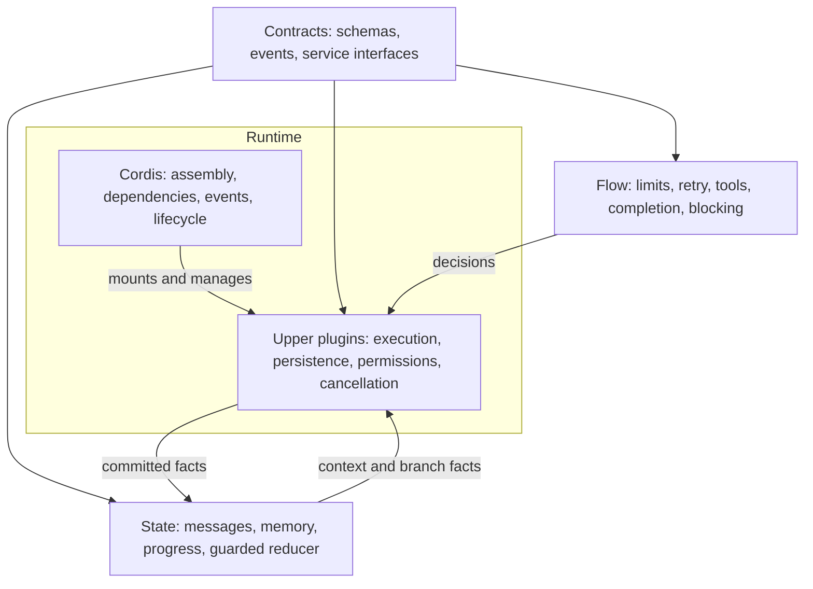
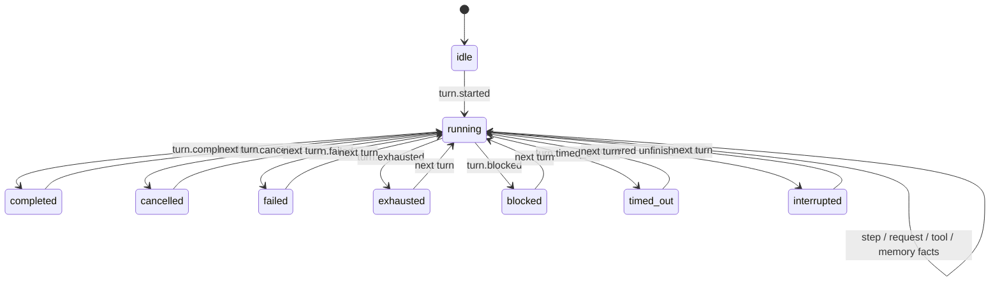

# Agent architecture: contracts, flow, state, runtime (0.3.0)

Cordis is the mandatory **runtime foundation**. It assembles plugins, resolves
service dependencies, dispatches events and manages plugin/resource lifetimes.
The Agent's execution policy, state model, persistence, tools and cancellation
are implemented by upper-layer plugins. Cordis itself does not define them.

## Four layers and dependency direction

| Layer | Responsibility | Implementation |
| --- | --- | --- |
| Contracts / protocols | Service methods, model/tool boundaries, event vocabulary and versions | `src/main/contracts/` |
| Flow / orchestration policy | Prompt policy, retry/compaction choices, tool/finish/block decisions and limits | `src/main/flow/` |
| State model | Pure guarded transitions of messages, memory, turn/step/request/tool progress | `src/main/state/session-state.js` |
| Upper runtime plugins | Execute policy, call services, commit facts, enforce cancellation/deadlines and persist state | `src/main/runtime/plugins/`, `run-turn.js`, `context-memory.js`, `state/session-repository.js` |
| Runtime foundation | Context, service graph, events, activation and teardown | Pinned actual Cordis bundle |



Contracts and flow import no IO, platform or runtime implementations. The state
reducer imports only contracts. The repository is an explicitly separate IO
adapter despite residing next to the state model. Runtime plugins depend on these
lower layers; the lower layers never import Cordis. Automated guards enforce
these boundaries and reject direct message mutation in the turn executor.

## Composition and executable entry points

`runtime/profile.js` only selects plugins. `runtime/plugins/foundation.js`
provides contracts, flow, state, settings, permissions, tools, prompts, context and
skills. Separate native plugins provide model access, persistence, compaction,
the turn executor and Agent creation.

HTTP/SSE and Electron IPC both await activation before serving work. AgentPool
keeps per-session workers/concurrency; the public Agent is a state/service facade.
Every turn invokes the selected `agentLoop` service. The executor consumes its
**injected Cordis service view** until the turn drains. Replacing flow or model
services therefore changes real execution, and dependency teardown cancels active
work before providers disappear. `agent/agent-loop.js` is a compatibility export.

## Contracts at real boundaries

- `contracts.SERVICES` specifies service method requirements checked at executor
  activation. Incomplete providers fail activation rather than silently falling
  back to another execution path.
- Model results are checked at the model adapter and executor boundaries,
  including tool names, argument encoding and duplicate IDs.
- Tool definitions and arguments are checked before approval and execution.
  Runtime validation covers the JSON Schema subset used by local tools: type,
  required, enum, properties, array items and additionalProperties. Remote `$ref`
  resolution and the full JSON Schema specification are not implemented.
- Durable domain events have explicit version, sequence, timestamp, type and
  payload. They are separate from the existing UI streaming events.
- `EVENT_MODES` describes extension events: `llm:request` / `tools:execute` use
  around middleware; `state:committed` is an asynchronous observation event after
  persistence. Observer failures are logged and do not undo committed facts.

Existing tool plugin APIs remain available through `PluginHost` / `PluginContext`
compatibility adapters. New core plugins use native Cordis contexts and `inject`.
There is no parallel service container, event registry or dependency scheduler.

## Flow and state

The pure `flow` service receives facts and returns explicit decisions. Its default
policy chooses tool fallback, context compaction, tool execution, completion,
permission blocking, maximum steps/attempts and an optional turn deadline. A
replacement policy is exercised through the same public Agent entry point.

The state reducer validates sequence and legal transitions. It owns the only
conversation state, with immutable messages, memory and execution records:



Execution state includes turn ID, phase, step, request attempt, active tool,
consecutive denials, tool-support fallback and last request error. Flow decisions
read these facts rather than maintaining competing flags. Streaming fragments and
AbortControllers are transient runtime resources, not durable state.

`turnTimeoutMs` defaults to `0` (no additional whole-turn deadline), capped at
24 hours. Model request timeouts still apply. Cancellation is cooperative: tools
receive an AbortSignal, and teardown waits for in-flight operations to settle.
An arbitrary trusted plugin that ignores cancellation cannot be forcibly undone.

`/api/state` and Electron state expose `executions` per live worker, in addition
to Cordis plugin diagnostics under `runtime`. The existing renderer event API and
legacy session JSON fields remain compatible.

## Persistence and recovery

The `sessions` plugin owns filesystem IO. Each session directory contains:

- `events.jsonl`: appended, versioned domain facts; continuous sequence numbers.
- `last-session.json`: atomic snapshot retaining `version: 2`, `messages` and
  `memory`, with additive `stateVersion`, `sequence` and `execution` fields.

For each change the runtime computes/validates the next state, appends the fact,
then exposes that state. Terminal snapshots are written for success, cancellation,
failure, denial limits, step exhaustion and deadline expiry. Old message-only
snapshots are migrated in memory without deleting user history.

On load the repository restores the snapshot and replays newer journal events.
A final line lacking its newline is an interrupted write and is truncated before
new appends. A malformed **committed** line, unknown version or sequence gap is an
error; it is not silently discarded. This is process-interruption recovery, not a
power-loss/fsync guarantee. The journal is currently retained without rotation.

An unfinished turn is recorded as interrupted before accepting the next turn.
Incomplete tool batches get explicit missing-result placeholders so model history
remains valid. Actual results from all tools in a batch are preserved. Recovery
restores context and progress; it does **not** automatically repeat uncertain
external side effects or promise exactly-once tool execution.

At idle, workers release heavy in-memory message payloads while retaining progress;
the next turn restores durable state. Explicit client history can replace the
conversation view, preserving the existing UI contract. Journal writers assume
one owning Agent service per session directory; they reject stale in-process
writers rather than offering distributed locking.

## Lifecycle and distribution

Cordis owns activation, dependency suspension/reactivation and asynchronous
cleanup. Settings disable/remount actual tool plugin fibers. Model/flow/loop
replacement drains dependent work; a failed replacement restores its predecessor.
Agent disposal closes its browser/background processes. Both application entries
await normal shutdown. Cordis is trusted in-process infrastructure, not a sandbox.

The actual upstream Cordis `4.0.0-rc.11` and cosmokit `1.8.1` are bundled as CJS
for Node 16.17, pinned with package integrities, SHA-256 and MIT notices. Production
has no package dependencies or runtime downloads. Do not edit generated code.

```sh
# Normal acceptance; no vendor install needed
npm run check
npm run check:node16
# Explicit upstream maintenance only; initial installation needs internet
npm ci --prefix scripts/cordis-vendor
npm run vendor:cordis
```

All desktop packages and Docker include contracts, flow, state, runtime plugins
and the offline Cordis bundle. Win7 SP1 x64 / Electron 22.3.27 remain mandatory.
Node 16 tests and cross-builds do not replace Windows hardware validation.
