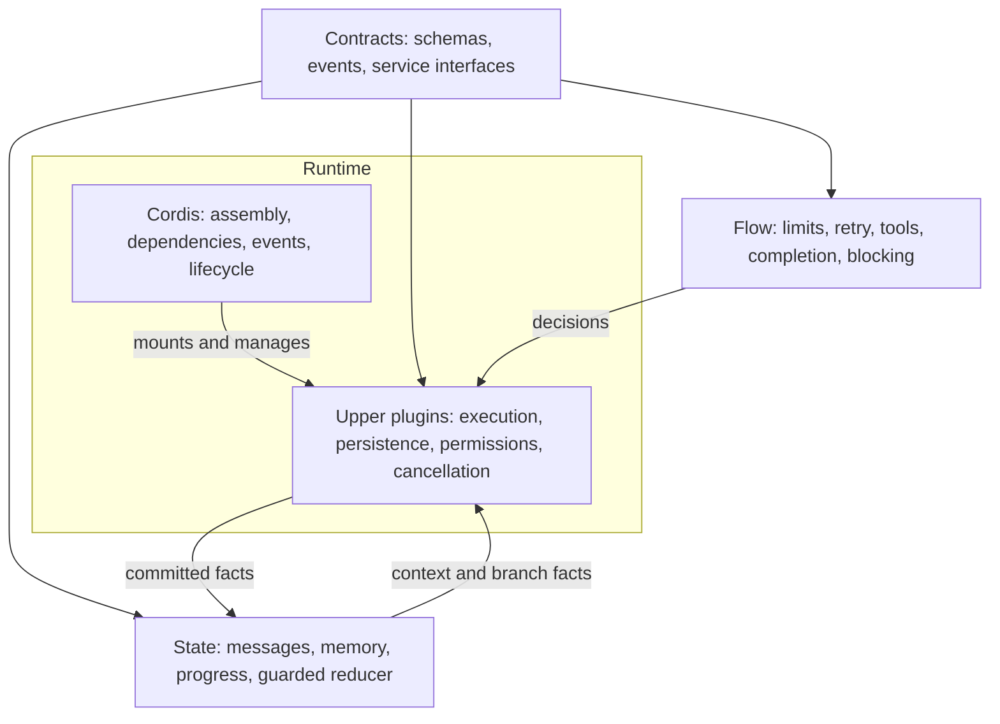
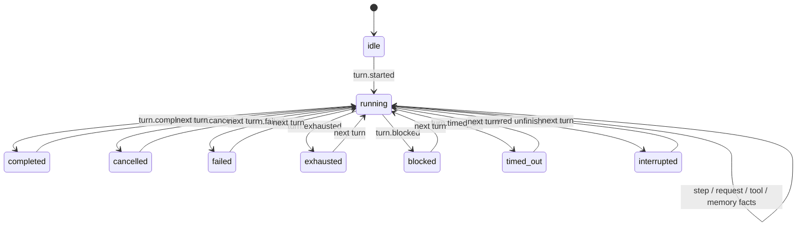

# Agent architecture: contracts, flow, state, runtime (0.3.0)

Cordis is the mandatory **runtime foundation**. It assembles plugins, resolves
service dependencies, dispatches events and manages plugin/resource lifetimes.
The Agent's execution policy, state model, persistence, tools and cancellation
are implemented by upper-layer plugins. Cordis itself does not define them.

## 长期设计原则：兼容的运行时，先进的架构

本项目只因 Windows 7 兼容性而约束运行技术版本，不因此降低架构设计标准。
交付运行时锁定 Electron 22.3.27 / Node 16.17.1 / Chromium 108；新能力通过
平台无关契约和可替换适配器落地。Cordis 插件装配、纯策略、受控状态迁移、事实日志、
取消与生命周期管理、可观测性和回归验证，是持续演进的基础。

技术选型不能以“最新版本”代替设计判断，也不能以“支持 Win7”解释耦合、隐式状态
或不可测试的实现。重要变更必须记录问题、边界、兼容方案、验证证据与替换路径。
完整长期规则见仓库根目录 `AGENTS.md`；平台约束见 `docs/WIN7-COMPAT.md`。

## Four layers and dependency direction

| Layer | Responsibility | Implementation |
| --- | --- | --- |
| Contracts / protocols | Service methods, model/tool boundaries, event vocabulary and versions | `src/main/contracts/` |
| Flow / orchestration policy | Prompt policy, retry/compaction choices, tool/finish/block decisions and limits | `src/main/flow/` |
| State model | Pure guarded transitions of messages, memory, turn/step/request/tool progress | `src/main/state/session-state.js` |
| Upper runtime plugins | Execute policy, call services, commit facts, enforce cancellation/deadlines and persist state | `src/main/runtime/plugins/`, `run-turn.js`, `context-memory.js`, `state/session-repository.js` |
| Runtime foundation | Context, service graph, events, activation and teardown | Pinned actual Cordis bundle |



Contracts and flow import no IO, platform or runtime implementations. The state
reducer imports only contracts. The repository is an explicitly separate IO
adapter despite residing next to the state model. Runtime plugins depend on these
lower layers; the lower layers never import Cordis. Automated guards enforce
these boundaries and reject direct message mutation in the turn executor.

## Composition and executable entry points

`runtime/profile.js` only selects plugins. `runtime/plugins/foundation.js`
provides contracts, flow, state, settings, permissions, tools, prompts, context and
skills. Separate native plugins provide model access, persistence, compaction,
the turn executor and Agent creation.

HTTP/SSE and Electron IPC both await activation before serving work. AgentPool
keeps per-session workers/concurrency; the public Agent is a state/service facade.
Every turn invokes the selected `agentLoop` service. The executor consumes its
**injected Cordis service view** until the turn drains. Replacing flow or model
services therefore changes real execution, and dependency teardown cancels active
work before providers disappear. `agent/agent-loop.js` is a compatibility export.

## Contracts at real boundaries

- `contracts.SERVICES` specifies service method requirements checked at executor
  activation. Incomplete providers fail activation rather than silently falling
  back to another execution path.
- Model results are checked at the model adapter and executor boundaries,
  including tool names, argument encoding and duplicate IDs.
- Tool definitions and arguments are checked before approval and execution.
  Runtime validation covers the JSON Schema subset used by local tools: type,
  required, enum, properties, array items and additionalProperties. Remote `$ref`
  resolution and the full JSON Schema specification are not implemented.
- Durable domain events have explicit version, sequence, timestamp, type and
  payload. They are separate from the existing UI streaming events.
- `EVENT_MODES` describes extension events: `llm:request` / `tools:execute` use
  around middleware; `state:committed` is an asynchronous observation event after
  persistence. Observer failures are logged and do not undo committed facts.

Existing tool plugin APIs remain available through `PluginHost` / `PluginContext`
compatibility adapters. New core plugins use native Cordis contexts and `inject`.
There is no parallel service container, event registry or dependency scheduler.

## Flow and state

The pure `flow` service receives facts and returns explicit decisions. Its default
policy chooses tool fallback, context compaction, tool execution, completion,
permission blocking, maximum steps/attempts and an optional turn deadline. A
replacement policy is exercised through the same public Agent entry point.

The state reducer validates sequence and legal transitions. It owns the only
conversation state, with immutable messages, memory and execution records:



Execution state includes turn ID, phase, step, request attempt, active tool,
consecutive denials, tool-support fallback and last request error. Flow decisions
read these facts rather than maintaining competing flags. Streaming fragments and
AbortControllers are transient runtime resources, not durable state.

`turnTimeoutMs` defaults to `0` (no additional whole-turn deadline), capped at
24 hours. Model request timeouts still apply. Cancellation is cooperative: tools
receive an AbortSignal, and teardown waits for in-flight operations to settle.
An arbitrary trusted plugin that ignores cancellation cannot be forcibly undone.

`/api/state` and Electron state expose `executions` per live worker, in addition
to Cordis plugin diagnostics under `runtime`. The existing renderer event API and
legacy session JSON fields remain compatible.

## Persistence and recovery

The `sessions` plugin owns filesystem IO. Each session directory contains:

- `events.jsonl`: appended, versioned domain facts; continuous sequence numbers.
- `last-session.json`: atomic snapshot retaining `version: 2`, `messages` and
  `memory`, with additive `stateVersion`, `sequence` and `execution` fields.

For each change the runtime computes/validates the next state, appends the fact,
then exposes that state. Terminal snapshots are written for success, cancellation,
failure, denial limits, step exhaustion and deadline expiry. Old message-only
snapshots are migrated in memory without deleting user history.

On load the repository restores the snapshot and replays newer journal events.
A final line lacking its newline is an interrupted write and is truncated before
new appends. A malformed **committed** line, unknown version or sequence gap is an
error; it is not silently discarded. This is process-interruption recovery, not a
power-loss/fsync guarantee. The journal is currently retained without rotation.

An unfinished turn is recorded as interrupted before accepting the next turn.
Incomplete tool batches get explicit missing-result placeholders so model history
remains valid. Actual results from all tools in a batch are preserved. Recovery
restores context and progress; it does **not** automatically repeat uncertain
external side effects or promise exactly-once tool execution.

At idle, workers release heavy in-memory message payloads while retaining progress;
the next turn restores durable state. Explicit client history can replace the
conversation view, preserving the existing UI contract. Journal writers assume
one owning Agent service per session directory; they reject stale in-process
writers rather than offering distributed locking.

## Lifecycle and distribution

Cordis owns activation, dependency suspension/reactivation and asynchronous
cleanup. Settings disable/remount actual tool plugin fibers. Model/flow/loop
replacement drains dependent work; a failed replacement restores its predecessor.
Agent disposal closes its browser/background processes. Both application entries
await normal shutdown. Cordis is trusted in-process infrastructure, not a sandbox.

The actual upstream Cordis `4.0.0-rc.11` and cosmokit `1.8.1` are bundled as CJS
for Node 16.17, pinned with package integrities, SHA-256 and MIT notices. Production
has no package dependencies or runtime downloads. Do not edit generated code.

```sh
# Normal acceptance; no vendor install needed
npm run check
npm run check:node16
# Explicit upstream maintenance only; initial installation needs internet
npm ci --prefix scripts/cordis-vendor
npm run vendor:cordis
```

All desktop packages and Docker include contracts, flow, state, runtime plugins
and the offline Cordis bundle. Win7 SP1 x64 / Electron 22.3.27 remain mandatory.
Node 16 tests and cross-builds do not replace Windows hardware validation.

## 0.4：界面计划与运行事实

`core/plans` 是 profile 中的原生 Cordis 插件，声明 tools/prompts 依赖，通过 effect
注册 update_plan 工具并回收资源。计划内容只是工具结果，沿既有 message.appended
事实落盘；共享插件中没有会话进度或第二套执行策略。前端从消息恢复计划展示。

execution.startedAt 来自 turn.started 事件时间，属于状态 reducer 派生事实，兼容旧快照。
工具 UI 事件附带已记录的 outcome 与调用 ID；失败的命令退出码经纯 flow.outcome 归类，
界面不得把取消、失败或历史未确认步骤重画成成功。其余计时与展开状态仅为 UI 元数据。

## 能力中心：系统技能与现有插件

能力中心将设置页现有插件管理迁出，继续调用既有 settings 与 Cordis 插件启停路径。
连接器保留未开放空页；定时任务由后述原生 `core/tasks` 服务提供真实执行能力。

`core/skill-library` 在 profile 注册，inject `agentConfig`，提供系统统一 `skillLibrary` 服务。
服务封装既有 Markdown 技能索引与读取；`disabledSkills` 由既有 Settings repository 持久化。
提示词清单、搜索和直接加载共同读取该全局配置；短名加载先解析稳定 ID 再判断开关。
旧配置无 disabledSkills 时所有系统技能默认启用，既有插件停用配置保持兼容。
HTTP 与 Electron 状态接口提供同一服务的技能清单，UI 不扫描磁盘、不执行技能脚本。
该变更不改变 Agent 状态迁移和会话日志；技能启停影响后续清单构建与工具加载，不能撤回
已进入模型上下文的内容。实现仅使用 Node 16 内置能力，无新增生产依赖；更换桌面运行时
只需替换传输适配，能力服务接口和页面可继续使用。

验证记录：源码语法检查与交付包源码一致性核对；不将跨平台构建作为 Win7 真机验证。

## 定时任务：应用运行期间的无人值守执行

`core/tasks` 是 profile 中的原生 Cordis 插件，inject agentConfig/agents/tools/contracts，
提供 `tasks` 服务。HTTP 与开发态 IPC 只是传输适配。调度器每 30 秒检查；资源由
Cordis effect 管理，关闭时取消任务并等待执行结束，再释放数据目录所有权。

- `contracts/tasks.js`：版本、任务字段、工具白名单和资源限制校验。
- `flow/task-policy.js`：纯日历与补跑策略，支持 IANA 时区、每天、每周、固定间隔。
- `state/task-state.js`：仅依赖契约的运行记录状态迁移。
- `tasks/repository.js`：原子 JSON 快照、备份及 JSONL 事实日志；每任务保留最近
  100 条、全局最多 1000 条；启动截断未提交尾行，运行中记录改为中断。
- `runtime/plugins/tasks.js`：持久化触发、推进下次时间、调度及结果汇总。

触发编号由任务 ID 和原计划时间决定，先记录 pending，再推进 nextAt；重启可恢复
尚未开始的 pending（超过 24 小时取消），不会重放已开始的副作用。正常调度允许
一分钟检查宽限；超过宽限的错过默认跳过，启用补跑时仅补最近 24 小时内的一次。
间隔规则按原计划推进而非按任务结束时间漂移。夏令时缺失时刻跳过，重复时刻只执行一次。

同任务 pending/running 时后续触发记录 skipped；全局仅一个后台任务，池有多个名额
时为交互运行保留一个名额。任务持有修订快照与规范化工作目录，聊天切换目录不改变它。
新增 runUnattended 入口仍调用同一个 Agent.run → Cordis agentLoop → 状态仓库。
任务记录只关联会话 ID，完整对话沿已有 sessions 目录保存。

权限在 ToolRegistry 执行边界检查，模型无法扩大任务白名单。只读任务不执行命令或
浏览器；workspace 命令需完整精确授权、根目录执行并通过现有危险命令策略。
浏览器仅查看及指定来源导航，拒绝脚本与交互写操作。文件访问复用真实路径检查。
命令不是 OS 沙箱，浏览器导航来源限制不是网络隔离；可信插件仍是宿主信任边界。
首次拒绝即停止本批后续工具，记录需人工处理，不等待人工审批。

任务独立设置最大步骤、超时、模型请求数、输出字节及 token 保守预算。请求前按
消息/工具定义 UTF-8 字节数、回复额度及协议余量预留，不等同于供应商计费 token；
无人值守关闭自动压缩与重试，避免额外模型调用绕过预算。连续非成功达到阈值自动停用。
磁盘写入错误使调度暂停并向界面报告，需要处理故障并重启服务。存在未授权操作、
失败或中断时，记录与桌面通知均不含原文件内容；浏览器用户通过运行记录查看结果。

桌面壳提供明确可选的托盘常驻与开机自启，默认不擅自开启；托盘模式关闭窗口仅隐藏，
托盘菜单真正退出并停止服务；Windows 通知使用托盘气泡以覆盖 Win7，临时托盘在通知后或退出时释放。单实例沿用原有壳锁，任务仓库额外用独占 PID 所有权
保护同一 AGENT_HOME。远程连接在页面标明实际执行主机。没有新增生产依赖或进程，
Electron 22.3.27 / Node 16.17.1 / Chromium 108 保持不变。日常任务完成后沿用当前版本构建开发环境验收包；明确发版时才升级并构建全部平台。


任务验收：`npm run check:tasks` 覆盖日历/时区、夏令时、补跑、独占所有权、
日志恢复、真实 Cordis/AgentPool 执行、越权拒绝、重叠跳过、配置快照、预算、停止、
超时、失败停用及桌面生命周期模拟。`npm run check:tasks:browser` 使用隔离目录、
本机模型替身及实际 Chromium，覆盖任务页面、工具执行、历史恢复、重启及删除。
桌面模拟检查不会修改开发机的开机自启设置；没有将其当作 Win7 真机通知验证。

## MCP：外部工具通过既有工具边界接入

`core/mcp` 是 profile 中的原生 Cordis 插件，inject `agentConfig/tools/prompts/contracts`，
在 `ctx.effect()` 生命周期内连接用户配置的 MCP 服务。`contracts/mcp.js` 只做纯配置、
命名和结果格式化；`flow/mcp-policy.js` 只做暴露策略；`mcp/stdio-client.js` 与
`mcp/http-client.js` 是 IO 适配器；`runtime/plugins/mcp.js` 负责注册/注销工具和
Cordis 服务。

MCP 工具不建立第二套执行路径：发现后的工具通过 `ToolRegistry.register()` 注册，
调用仍经过 `ToolRegistry.execute()` 的权限、审批、取消与禁用插件检查。服务关闭时
工具 disposer 会中止在跑的 MCP 调用并等待子进程退出。HTTP 使用 Streamable HTTP，
stdio 使用按行 JSON-RPC；均只依赖 Node 16 内置模块，不增加运行时下载。

配置和连接状态不进入会话状态 reducer，也不伪造计划/进度事实。宿主仅暴露工具结果；
MCP resources/prompts/sampling 尚未实现，未知能力返回 JSON-RPC 错误。
验证入口为 `npm run check:mcp`，覆盖真实 stdio/HTTP 假服务与 Cordis 工具注册。

### 内置文档 MCP

`core/mcp` 使用注入的 tools/prompts 装配随包文档服务。纯契约
`contracts/document-tools.js` 定义六个工具及 Schema；`mcp/documents/host.js` 是
MCP 客户端适配，每次调用以可信 toolCtx.workspaceRoot 启动独立 stdio 进程，完成真实
握手、发现和调用，不将会话目录放到共享插件状态。读取/写入分别走现有 read/write
权限，调用事实仍走原有会话 reducer/repository，不新设执行循环或文档事件总线。

`mcp/documents/server.js` 是可由其他客户端启动的标准 MCP 服务端，处理初始化、
JSON-RPC 错误、通知及工具结果；service/zip/xml/ooxml 为限定范围的本地文档 IO 适配。
只支持基础 DOCX/XLSX；写入始终另存、版本校验、独占发布，不自动重放副作用。
进程和在途调用由 Cordis 插件卸载路径取消并等待清理，按需启动不引入常驻服务。
只使用 Node 16 内置模块，不增加生产依赖；未来可以替换 OOXML 处理器或执行平台，
MCP Schema、权限边界和会话事实协议可保持不变。范围及限制见 docs/MCP.md。

## 知识库基础服务（2026-10-18）

`core/knowledge` inject agentConfig，在 Cordis effect 中拥有懒加载的知识库 repository，
按需执行固定随包 SQLite bridge；`core/knowledge-tools` inject knowledge/tools/prompts，
通过既有 ToolRegistry 注册只读搜索和来源读取，权限与 Agent 会话事实链路保持不变。
contracts/knowledge、flow/knowledge-policy、纯 knowledge-job-state reducer 与 IO 仓库分离。
导入任务每次状态迁移和事件同事务，未发布 version 的分块不会进入检索；失败不替换旧 active。

原件先临时写入、fsync、按哈希独占发布；解析在有资源/时限的可终止 worker 中执行。
SQLite 与原件无法跨介质原子提交，允许不可见孤儿，不发布缺失原件。导入重启标记中断，
不重放外部副作用。知识库位于 AGENT_HOME，访问通过来源 ID 与项目关联检查，不能将其
伪装成工具 workspaceRoot。第一轮每库单项目关联，无会话单独选库；无人值守访问默认拒绝。

`server/knowledge-api.js`/开发态 IPC 是薄适配，二进制上传有界，不接收服务端任意路径；
UI 页面不直接访问 SQLite。既有文档 MCP 保持独立，知识库复用 OOXML 只读处理器。
SQLite 3.54.0 为明确记录的离线组件例外，源码、构建参数、许可与校验入库，不依赖目标机
Python/SQLite/Office，不增加 Node addon 或第二个 Agent 容器。未来存储执行组件可替换。
验证与未完成边界见 KNOWLEDGE-STORAGE-ADR.md，Win7 真机验证和跨构建须分开报告。

## 桌面启动：后台接管日常验收包（2026-10-18）

Shell 在创建窗口和获取单实例锁之前判断安装登记。同版本、同目录也以应用代码
SHA-256 指纹识别新构建；不能先覆盖旧 PID 登记，否则会丢失需要停止的实例。
确认旧 PID 仍属于登记的可执行文件后关闭它，替换到稳定原位置并重启；同目录或
macOS AppTranslocation 情况直接启动本次新程序，不复制覆盖自身或临时挂载。

正常更新不创建窗口、不加载 update.html，也不等待用户确认。重启子进程必须用
实际 buildId/PID 登记确认接管成功；失败时旧实例已退出且新源包可用，才回退到
直接启动本次新包。不能静默唤回旧程序。安装登记只在取得锁后写入，使用原子替换。
底层更新函数保持幂等，进程身份和文件复制属于 Shell 平台适配，不进入 Cordis
Agent 业务契约或状态 reducer。隔离测试覆盖启动分支、同版本/同路径、内容替换、
无更新窗口、启动确认、失败回退和 PID 复用保护；不实际替换开发者安装目录。

### Reopening an overwritten desktop package

macOS LaunchServices may only activate an already running process when the same
app is reopened. The shell therefore captures its package fingerprint at boot
and compares disk contents on `activate` and `second-instance`. Changed contents
schedule one native relaunch, with the existing graceful service teardown before
exit; the same build only focuses its window. This uses Electron 22 APIs and
keeps platform lifecycle work outside Agent policy. Older shells without this
handler require one complete exit before this behavior takes effect. Regression
coverage exercises unchanged contents, overwritten contents and duplicate events;
this is not evidence of a Windows 7 hardware test.

### Knowledge-associated regular conversations

Knowledge sessions are regular recent conversations with an explicit, durable
Knowledge binding, mutually exclusive with project membership. The existing
Cordis Knowledge service owns the binding and session-file repository; AgentPool
resolves its context after reserving a run, then runs the existing Agent with a
session-owned workspace. Global project changes cannot replace that workspace.
Deletion rejects active runs, records a durable tombstone and removes only that
session's owned directory. Project files, imported materials and other sessions'
files are outside this deletion contract. Read/preview recheck the association
and real paths. See the storage ADR and knowledge-session-smoke for the schema3
migration, boundaries and verification; platform support remains Node16/Win7.

### 工作流业务模块

工作流通过 profile 中的 `core/workflow-nodes` 与 `core/workflows` 原生 Cordis 插件提供。版本化图契约、纯拓扑策略、事件 reducer 和独立事实仓储分别归属 contracts / flow / state / workflows；画布仅编辑契约，不承担运行时调度。节点能力复用注入的 llm 服务，运行事实独立于会话和知识库。详见 [工作流实现与边界](WORKFLOWS.md)。

### 内存与资源生命周期

工作流画布通过应用适配器拥有可取消RAF和精确事件解绑；历史实例使用轻量索引及有界详情缓存，事实不因缓存淘汰删除。模型传输在结束/失败时释放连接并限制异常响应体积，预览URL有全局缓存边界。验证方法、兼容实现及限制见 [内存排查记录](MEMORY-RELIABILITY.md)。
